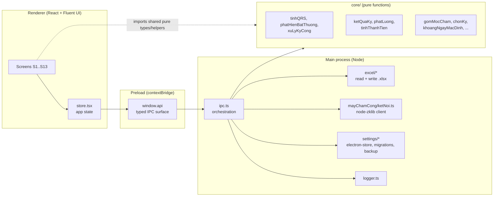
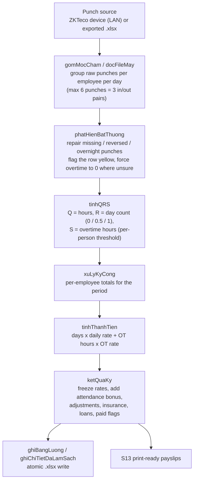

# Timesheet Calculator


A Windows desktop app that turns raw fingerprint-machine punches into hours, overtime and pay. It reads attendance data from a ZKTeco-compatible time clock (over the LAN) or from an exported Excel file, repairs the usual human mistakes (forgotten punches, shifts that cross midnight), computes working days and overtime per employee, writes the result into an Excel payroll sheet, and prints payslips.

The UI is in Vietnamese (the app was built for a small Vietnamese workshop); code identifiers and domain terms are Vietnamese as well, and this README explains them.

> **All data in this repository is synthetic.** Employee names, wage rates, punch times and the payroll template were generated for demonstration. No real company or personal data is included.

---

## Problem

A small workshop with ~15 employees tracks attendance on a fingerprint machine. Every month the bookkeeper:

1. exports the punch log to Excel,
2. fixes the days where someone forgot to punch in/out or punched across midnight,
3. computes worked days and overtime hours for every person by hand, with a different overtime threshold per person,
4. copies the numbers into a hand-made payroll sheet, adds bonuses and deductions, and
5. prints a payslip for everyone.

It takes hours, and a single wrong cell silently means someone is paid wrong. This app automates steps 1-5, keeps every automatic correction visible and editable, and produces the same Excel layout the bookkeeper already uses.

## Features

Organised by screen / module (the screen ids `S1`..`S13` are used in the code):

| Area | What it does | Code |
| --- | --- | --- |
| **Load data (S1)** | Import a punch file exported from the machine (`.xlsx`) or pull the log straight from the device over the LAN (`node-zklib`, default port 4370, 5 s hard timeout). The default date range is chosen from the day of month (see rules below). On startup the app can re-run the last successful source automatically. | `main/mayChamCong/ketNoi.ts`, `main/excel/docFileMay.ts`, `core/gomMocCham.ts`, `core/khoangNgayMacDinh.ts`, `core/nguonGanNhat.ts` |
| **Summary (S2, S7)** | Per-employee totals for the period: worked days, overtime hours, amount due, and a count of rows that need a look. | `core/xuLyKyCong.ts`, `core/tinhThanhTien.ts` |
| **Explain and fix (S8)** | Raw punches next to the computed values for every day, with the reason for each automatic correction. Punches can be edited by hand, or the day count can be set directly (0 / 0.5 / 1). Manual edits are persisted and re-applied on the next auto-load. | `core/xuLyKyCong.ts`, `core/phatHienBatThuong.ts`, `core/ghiChuNgay.ts` |
| **Monthly grid (S11)** | A month-at-a-glance grid: `X` full day, `1/2` half day, `CN` Sunday, absent. | `core/luoiCong.ts` |
| **Employee setup (S5, S4)** | Employee list with machine name, payroll name, daily rate, overtime rate and the per-person "standard hours" threshold. If someone in the punch data is not set up, the calculation is blocked with a clear list instead of guessing. | `main/settings/nhanVien.ts` |
| **Export (S6)** | Writes the payroll workbook (two-column card layout, one card per employee) and a cleaned "detail" workbook (a summary sheet plus one sheet per employee). Cards are matched by employee code; only the day count, overtime hours and rate cells are written, so bonus/deduction cells the bookkeeper typed by hand are left alone, and employees without a card get one built from a fixed grid. | `main/excel/ghiBangLuong.ts`, `main/excel/ghiChiTietDaLamSach.ts` |
| **Dashboard (S9)** | Saved periods as cards, with totals, paid / unpaid status. Every period is auto-saved when computed or edited. | `core/ketQuaKy.ts`, `main/settings/store.ts` |
| **Payout (S10, S12)** | Pay-run list: advance, bonus, holiday pay, insurance and loan columns, an automatic attendance bonus, a "paid" checkbox per person, and a marker showing how far net pay moved from the value when the screen opened. Per-person view explains the five components of net pay. | `core/phatLuong.ts`, `core/ketQuaKy.ts` |
| **Payslips (S13)** | Print-ready payslips (3 per page) including the amount written out in Vietnamese words. | `core/soTienBangChu.ts`, `renderer/.../S13InPhieuLuong.tsx` |
| **Display settings** | Font scale, row height, light/dark theme and a high-contrast mode (the main user has poor eyesight). | `core/hienThi.ts`, `renderer/.../BangHienThi.tsx` |
| **Safety** | Atomic Excel writes, a `config.json.bak` backup before every schema migration, up/down migrations, structured JSON logs, a friendly message when the target file is open in Excel. | `main/excel/ghiAtomic.ts`, `main/settings/saoLuu.ts`, `main/settings/migrations.ts`, `main/logger.ts` |

## Architecture

The app follows the standard Electron split, with one deliberate rule: **all domain logic lives in `src/core/` as pure TypeScript** (no Electron, no `fs`, no `exceljs` imports), so it can be unit-tested without a window and reused by both processes.



Data flow for one pay period:



## Domain rules (derived from the code)

| Rule | Behaviour | Where |
| --- | --- | --- |
| Worked hours `Q` | 4 punches: `(out1 - in1) + (out2 - in2)`. Only pair 1: `out1 - in1`. Otherwise 0. A third pair is read and kept for display but is not added (it matches the bookkeeper's original spreadsheet formula). | `core/tinhQRS.ts` |
| Day count `R` | `Q = 0` -> 0; `Q < 5.5` -> 0.5; otherwise 1. | `core/tinhQRS.ts` |
| Overtime `S` | Per-employee threshold `T` (e.g. 8.1 h; a driver might have 10.6). `S = Q - T` only when `Q > T + 0.1`, compared at 2 decimals so floating-point dust (`8.1 + 0.1 = 8.200000000000001`) cannot flip a result. | `core/tinhQRS.ts` |
| Missing punch in a pair | Filled from the nearest day with four raw punches (earlier day first, then later); row flagged; overtime forced to 0. | `core/phatHienBatThuong.ts` |
| Three punches in a day | Each punch is assigned to the slot (in-am / out-am / in-pm / out-pm) closest to that person's habitual time, taken as the median of their complete days in the period (defaults 07:00 / 11:30 / 13:30 / 17:30). | `core/phatHienBatThuong.ts` |
| Reversed pair / shift past midnight | The stray punch is dropped, then handled as a missing punch. | `core/phatHienBatThuong.ts` |
| Shift longer than 14 h (2+ pairs) | Hours kept for the day count, overtime forced to 0 (probably a forgotten lunch punch). | `core/phatHienBatThuong.ts` |
| One in/out pair only | No overtime, no warning. Covers lunch (in before 12:00, out after 13:30) -> full day; otherwise half day. | `core/phatHienBatThuong.ts` |
| No punches | Treated as a day off: no warning, everything 0. | `core/phatHienBatThuong.ts` |
| Amount due | `round(days x daily rate + OT hours x OT rate)`. | `core/tinhThanhTien.ts` |
| Net pay | amount due + attendance bonus + top-up + holiday pay - insurance - loan/advance. Rates are frozen into the saved period so a later rate change does not rewrite history. | `core/ketQuaKy.ts` |
| Attendance bonus | Below 27 days: 0. At 27 days: 100,000 VND, plus 50,000 for each extra half day (28 days = 200,000); a remainder shorter than half a day is ignored. A manually typed value always wins over the automatic one. | `core/ketQuaKy.ts` |
| Cash rounding | Nearest 1,000 VND, only for the cash-in-hand figure. | `core/ketQuaKy.ts` |
| Default period | Day of month <= 5 -> the whole previous month (pay days are the 1st-5th); otherwise the 1st of this month until today. | `core/khoangNgayMacDinh.ts`, `core/chonKy.ts` |
| Machine settings | IPv4 and port are validated; port defaults to 4370 (the node-zklib default). | `core/mayChamCong.ts` |

## Engineering highlights

- **Pure domain core.** `src/core/` has no I/O; the Electron main process only orchestrates (`ipc.ts`). The renderer imports the same pure helpers, so the date-range rule, for example, exists in exactly one place.
- **Typed IPC surface.** `preload/api-types.ts` defines the whole `window.api` contract; payloads that are unions of mutually exclusive shapes are modelled as discriminated unions so TypeScript rejects an invalid call at build time.
- **Versioned settings with up/down migrations.** `config.json` (via `electron-store`) carries a `schemaVersion`; every migration step has an `up` and a `down`, the version number is written last (so a crash mid-migration re-runs it), and a `.bak` copy is taken before any schema change. `npm run migrate` runs migrations outside Electron.
- **Defensive persistence.** Unknown or corrupted fields fall back to defaults field by field instead of throwing; old saved periods that lack newer fields keep loading.
- **Atomic Excel writes.** Workbooks are written to a temp file and renamed over the target, so a failed write never truncates the previous file; "file is open in Excel" is detected and reported in plain language.
- **Do not clobber hand-entered data.** Exports touch only the machine-derived cells of a payroll card, and importing employees from an earlier payroll file fills blanks without overwriting names or rates already set up.
- **Explainability.** Every automatic correction is marked on the row and explained in words in the UI and in the exported detail workbook.
- **Tests.** 29 vitest files covering the calculation rules (including boundary cases found by back-testing against past periods), pay-run logic, Excel round-trips, migrations and backup, machine log grouping, display settings and a full punches-to-Excel pipeline smoke test.
- **CI.** GitHub Actions runs typecheck, lint, tests and a production build on every push and pull request.

### Honest limitations

- Windows only for packaging (NSIS installer); development and tests run anywhere Node 20 runs.
- UI language and domain naming are Vietnamese only; there is no i18n layer.
- The synthetic payroll template is a blank grid; the original business template (with real names) is intentionally not part of this repo. Test suites that need real exported files (`deployment/local/mau/`) are skipped automatically when the files are absent: 23 tests are skipped for that reason.
- The device client has been exercised against one ZKTeco-compatible model only; it opens and closes a connection per fetch and does not push data back to the device.
- There is no code signing, auto-update, or end-to-end UI test suite in this repo; UI behaviour was verified by hand.
- Overtime and attendance-bonus rules encode one workshop's policy; they are not configurable from the UI.

## Tech stack

| Layer | Choice |
| --- | --- |
| Shell | Electron 31 |
| Build | electron-vite 2, Vite 5, electron-builder 24 (NSIS) |
| UI | React 18, Fluent UI React v9 |
| Language | TypeScript 5 (strict), three tsconfig projects (node / web) |
| Excel | exceljs 4 |
| Device | node-zklib |
| Persistence | electron-store 8 (JSON `config.json`) |
| Tests | vitest 1 |
| Lint | ESLint 8 with typescript-eslint, react, react-hooks |
| CI | GitHub Actions (Node 20) |

## Getting started

Requirements: Node.js 20+, npm. Windows is needed only to build the installer.

```bash
npm ci

# run the app with hot reload
npm run dev

# type-check (main + renderer), lint, test, production build
npm run typecheck
npm run lint
npm test
npm run build

# build the Windows installer into deployment/dist/
npm run dist
```

Demo data: point the app at the synthetic employee list and punch fixture.

```bash
# bash
TSC_SEED_FILE=deployment/local/nhan-vien-seed.json npm run dev
# PowerShell
$env:TSC_SEED_FILE = "deployment/local/nhan-vien-seed.json"; npm run dev
```

`deployment/local/nhan-vien-seed.json` holds 13 fictional employees; `deployment/local/moc-cham-fake.json` is a month of fake raw punches (user id + timestamp only).

### Environment variables

All optional, for development and tests (see `deployment/.env.example`):

| Variable | Purpose |
| --- | --- |
| `TSC_CONFIG_DIR` | Override the config/log directory (default `%APPDATA%/timesheet-calculator/`). |
| `TSC_LOG_LEVEL` | `info` or `debug`. |
| `TSC_SEED_FILE` | JSON list of employees loaded when the store is empty. |
| `TSC_SEED_KETQUAKY` | JSON map of saved periods loaded when none exist (dashboard demo). |
| `TSC_MAU_BANG_LUONG` | Override the payroll template path (not honoured in a packaged build). |

`npm run doctor` checks Node/npm, the installed dependencies and write access to the config directory. `npm run mau-bang-luong` regenerates the blank payroll template at `resources/mau-bang-luong.xlsx`.

## Testing

```bash
npm test          # vitest run
```

Last run: **29 test files passed, 2 skipped; 252 tests passed, 23 skipped** (the skipped suites need real exported files that are not in the repo). `npm run typecheck` and `npm run lint` (zero warnings allowed) are clean.

Covered areas: the Q/R/S formulas and their rounding boundaries, anomaly detection and repair, default period selection, monthly grid symbols, amount-in-words, pay-run calculation and attendance bonus, saving/merging periods (including old shapes), payroll card parsing (two-column layout, codes glued to names), payroll and detail exports, machine log grouping, config round-trips, migrations v1 <-> v2 and backup, theme token regressions, and a pipeline smoke test from punches to Excel.

## Project structure

```
src/
  core/            pure domain logic (rules, pay, period selection) - no Electron/fs
  main/
    excel/         read punch/payroll files, write payroll + detail workbooks, atomic write
    mayChamCong/   node-zklib client for the time clock
    settings/      electron-store access, migrations, backup, employee list
    ipc.ts         IPC orchestration       logger.ts  JSON-lines log
  preload/         contextBridge API + shared type contract
  renderer/        React app: screens S1..S13, store, theme.css
tests/             vitest (core, renderer tokens, pipeline smoke)
scripts/           doctor, payroll-template generator, build-cache prep
deployment/        env example, synthetic seed and punch fixture
resources/         generated blank payroll template (embedded into the installer)
```

## Roadmap

- Make overtime / attendance-bonus policy configurable per company.
- English locale and a real i18n layer.
- Playwright-driven end-to-end tests for the main flows.
- Code signing and auto-update for the installer.

## License

MIT - see [LICENSE](LICENSE).

## Author

**Ngo Le Bao Loc** - backend developer
GitHub: [baoloc1993](https://github.com/baoloc1993) - Email: baoloc1993@gmail.com
